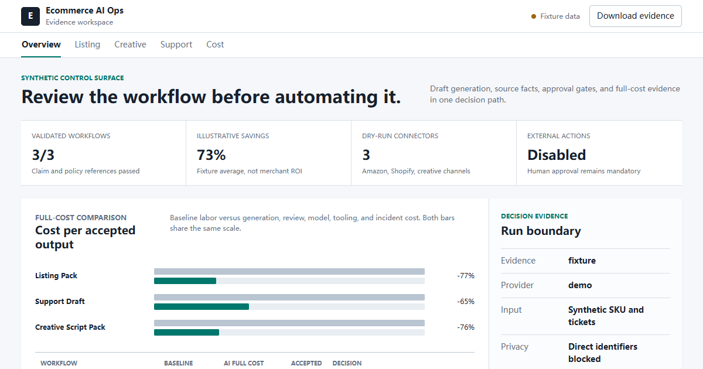

# Ecommerce AI Ops Lab

A local-first experiment for measuring whether AI actually reduces ecommerce
operating cost. It turns synthetic product, support, and cost inputs into drafts
and an evidence pack. Nothing publishes, messages customers, issues refunds, or
changes inventory.

[Live evidence dashboard](https://firejw.github.io/ecommerce-ai-ops-lab/) |
[Experiment protocol](https://github.com/FireJW/ecommerce-ai-ops-lab/blob/main/docs/EXPERIMENT.md) |
[Safety model](https://github.com/FireJW/ecommerce-ai-ops-lab/blob/main/SECURITY.md)

[](https://firejw.github.io/ecommerce-ai-ops-lab/)

## Included capabilities

- Amazon-style listing pack with source fact IDs and prohibited-claim checks.
- TikTok/YouTube-style creative script pack with compliance notes.
- Shopify/Gorgias-style support classification and response drafts.
- Full-cost calculator that includes generation, review, tools, and incidents.
- Localhost JSON API and an importable n8n review-loop workflow.
- Privacy gate that rejects common direct identifiers before model calls.
- Dry-run Amazon, Shopify, TikTok Ads, and YouTube Shopping request manifests.

The fixtures are synthetic. A fixture result is never evidence that a real
merchant saved money.

## Quick start

Requirements: Node.js 22 or newer.

```powershell
npm install
npm test
npm run demo
```

The demo writes `outputs/evidence-pack.json`. That directory is ignored by Git.

Start the local API:

```powershell
npm run serve
```

It binds only to `http://127.0.0.1:4317`. Available routes are `/health`,
`/v1/listing`, `/v1/creative`, `/v1/support`, `/v1/cost`, and the three
`/v1/connectors/*` routes.

Evaluate a redacted, measured experiment:

```powershell
npm run experiment -- D:\path\to\redacted-measurement.json
```

The input contract and two-week procedure are in `docs/EXPERIMENT.md`.
The evaluator accepts aggregate metrics only, rejects unknown or unsafe fields,
and never overwrites an existing study result.

Pre-register the default low-risk support pilot before collecting measurements:

```powershell
npm run pilot:plan -- D:\path\to\redacted-pilot-plan.json
```

See `docs/PILOT.md` for the fixed schedule, stop conditions, and handoff to the
measured experiment input.

## Real model mode

The default provider is deterministic and offline. To opt into an OpenAI model,
set credentials only in the current shell. The lab deliberately does not choose
a model for you because model availability varies by account.

```powershell
$env:MODEL_PROVIDER = "openai"
$env:OPENAI_API_KEY = "<session-only key>"
$env:OPENAI_MODEL = "<model available to your account>"
npm run demo
```

OpenAI SDK integration uses the Responses API through
https://github.com/openai/openai-node. Current official documentation should be
checked before selecting or changing a production model; the official docs host
was inaccessible from this machine during initial implementation.

## n8n handoff

1. Start this lab with `npm run serve`.
2. Import `workflows/n8n/ecommerce-ai-review-loop.json` into your own n8n.
3. Run it manually. The final node intentionally stops for human review.

n8n is not installed or bundled. Docker was not available on this machine, and
n8n's source-available license should not be described as standard open source.

## Production gates

Before any Amazon, Shopify, TikTok, or YouTube publishing connector is enabled:

1. Replace fixtures with redacted exports and record explicit data retention.
2. Run a two-week control experiment with matched products or tickets.
3. Require at least 30% full-cost savings with zero material guardrail failures.
4. Review OAuth scopes and keep refunds, address changes, discounts, purchasing,
   and publishing behind human approval.
5. Recheck every generated factual claim against the source fact snapshot.

See `docs/CASES.md` for case evidence and `docs/UPSTREAMS.md` for integration
status and licenses.

Before any commit or remote setup, run `npm run verify`. GitHub Actions runs the
same tests, privacy scan, and package preview without access to repository
secrets.
